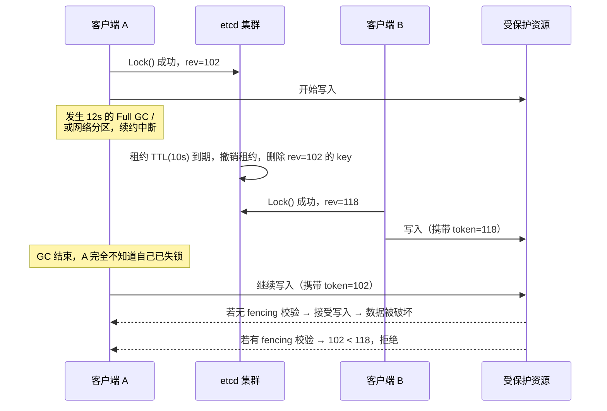

# etcd 分布式锁实现原理详解

etcd 之所以被广泛用作分布式锁服务，不是因为它的 API 里恰好有个叫 `Lock` 的方法，而是因为它把实现分布式锁所需的四块积木一次性给全了：**强一致写（Raft）、全局单调版本号（Revision）、带 TTL 的会话（Lease）、事件推送（Watch）**。理解这四块积木如何咬合，比背任何一段代码都重要。

本文从"一把合格的锁要满足什么"出发，逐层拆解 etcd 的实现原理、官方 `concurrency` 包的源码逻辑、八类生产异常场景，最后给出一个多数文章都会漏掉的结论：**etcd 官方明确说明，它的 lock API 本身并不能保证互斥**。

------

## 一、先立标准：一把合格的分布式锁要满足什么

在讨论"怎么实现"之前，先明确"实现成什么样才算对"。下面六个维度是后文所有设计取舍的参照系。

| 维度                  | 含义                                 | 不满足的后果                         |
| --------------------- | ------------------------------------ | ------------------------------------ |
| **互斥性**            | 任意时刻最多一个客户端持有锁         | 并发写坏数据，重复扣款               |
| **防死锁**            | 持有者崩溃后锁能自动释放             | 资源被永久锁死，需人工介入           |
| **归属可校验**        | 释放锁时能确认"锁是我的"             | A 超时后误删 B 的锁，连锁雪崩        |
| **容错性**            | 锁服务自身部分节点故障时仍正确工作   | 脑裂，出现两个"合法"持有者           |
| **公平性**            | 等待者按先来后到获得锁，且不惊群     | 某些客户端饿死；锁释放瞬间打爆服务端 |
| **正确性（fencing）** | 失效的旧持有者无法继续操作受保护资源 | GC 停顿后"复活"的旧持有者写入脏数据  |

前五个是常规要求，几乎所有介绍分布式锁的文章都会讲到。**第六个是最常被忽略、也是唯一能让锁在异步网络模型下真正安全的一环**——etcd 官方文档专门为此写了一节免责声明，详见第七章。

------

## 二、etcd 的五块基石

### 2.1 Raft 多数派：写入的强一致

etcd 的所有写请求都经由 Raft 日志复制到集群多数派后才返回成功。官方对 API 保证的表述是：所有 API 调用保证**顺序一致性**（sequential consistency）；除 watch 之外的操作默认保证**线性一致性**（linearizable）；隔离级别为**可串行化**（serializable）<sup>[2]</sup>。

这一层直接对应第一章的"容错性"维度：只要集群还有多数派存活，就不会出现两个客户端同时创建同一个 key 都成功的情况——这是 Redis 主从架构（异步复制）无法提供的保证。

代价是写延迟：每次写都要走一轮共识 + 磁盘 fsync，这也是 etcd 锁在性能量级上慢于 Redis 锁的根本原因。

### 2.2 Revision：全局单调递增的逻辑时钟

Revision 是 etcd MVCC 层维护的**全局单调递增版本号**，结构为 `{Main, Sub}`：

- `Main`：每次写事务提交时递增，整个集群共享同一个计数
- `Sub`：区分同一事务内的多个写操作

每个 key-value 上都挂着三个版本字段，容易混淆，务必分清：

| 字段              | 含义                                        |
| ----------------- | ------------------------------------------- |
| `create_revision` | 该 key **首次被创建**时分配的 Main revision |
| `mod_revision`    | 该 key **最后一次被修改**时的 revision      |
| `version`         | 该 key 被修改的次数                         |

因为所有写都挤过同一条 Raft 全序日志，revision 实质上是一个由共识背书的严格全序时钟。它对分布式锁有两个不可替代的作用：

1. **天然的排队号**。多个客户端并发抢锁时，谁的 `create_revision` 小谁先拿到锁，顺序在写入的那一刻就已确定，后续任何人释放锁都不会改变排队次序——这是实现公平锁的基础。
2. **天然的 fencing token**。每次成功创建锁 key 都会得到一个比之前更大的 revision，资源侧只要拒绝"比自己见过的最大令牌更旧"的请求，就能挡住失效的旧持有者。

### 2.3 Lease（租约）：带 TTL 的会话

租约是客户端与 etcd 服务端之间的一个约定：服务端保证在 TTL 内不删除关联到该租约上的 key；若客户端未在有效期内续约，服务端撤销租约并删除其关联的所有 key。

相关 API：

| API                 | 作用                                                         |
| ------------------- | ------------------------------------------------------------ |
| `Grant(ttl)`        | 创建租约，返回 64 位 LeaseID，租约元数据持久化到 boltdb      |
| `KeepAlive(id)`     | 建立长连接持续自动续约，返回一个 channel；channel 关闭即表示续约中断 |
| `KeepAliveOnce(id)` | 只续约一次，需客户端自行按周期调用                           |
| `TimeToLive(id)`    | 查询租约剩余时间                                             |
| `Revoke(id)`        | 主动撤销租约，关联 key 立即被删除                            |

服务端实现上有三个细节值得注意：

- 过期扫描由 `runLoop` 以 **500ms** 为周期触发，且**只在 Leader 节点执行**
- `Revoke` 时，删除关联 key 与删除 lease 元数据在**同一个 backend 事务**内完成，防止中途失败导致状态不一致
- 存在 **checkpoint 机制**，周期性持久化 `remainingTTL`，用于 Leader 切换后恢复租约剩余时间

租约对应第一章的"防死锁"维度：客户端崩溃 → 心跳停止 → 租约到期 → 锁 key 自动删除 → 后继者获得锁。**代价是其他客户端最长需要等待一个 TTL 才能感知故障。**

与 ZooKeeper 对比：ZK 的临时节点绑定"会话"，客户端只要维持 TCP 连接，生命周期由服务端隐式管理；etcd 的租约是**显式**的，客户端必须主动调用 `KeepAlive`。显式设计换来更精确的控制力，代价是客户端实现复杂度更高。

### 2.4 Txn（事务）：If-Then-Else 形式的分布式 CAS

etcd v3 的事务是多键条件事务，语义类似三元表达式：

```text
If   <一组比较条件全部成立>
Then <执行这组操作>
Else <执行另一组操作>
```

`If` 部分可比较的 target 有五类：

| Target                | 用途                                  |
| --------------------- | ------------------------------------- |
| `Value(key)`          | 比较值，常用于归属校验                |
| `Version(key)`        | 比较修改次数                          |
| `CreateRevision(key)` | **判断 key 是否存在**（不存在时为 0） |
| `ModRevision(key)`    | 乐观锁，比较最后修改版本              |
| `Lease(key)`          | 比较绑定的租约 ID                     |

整个 Txn 在 Raft 层作为一个原子单元提交，只分配一个 revision。`If(CreateRevision(key), "=", 0) Then Put(key)` 就是标准的"不存在才创建"（Compare-And-Swap），它直接对应第一章的"互斥性"维度：**无论多少客户端并发提交这个事务，集群只会让一个成功。**

### 2.5 Watch：事件驱动的等待

Watch 基于 gRPC 长连接（HTTP/2）向客户端推送 key 变更事件，关键性质：

- **有序**：事件按 revision 排序，不会出现"时间上更早的事件在更晚的事件之后送达"
- **可续订**：创建 watch 时可指定起始 revision，客户端断线重连后能从"自己看到的最后一个逻辑时刻"无缝续订，不丢不重
- **不丢事件**：服务端将 watcher 分为 synced / unsynced / victim 三类分别处理；当客户端消费过慢导致 channel buffer（默认 1024）写满时，该 watcher 会被移入 victim 集合并由 `syncVictimsLoop` 异步重投，而不是丢弃事件

Watch 解决的是"等待锁释放"的效率问题。没有 Watch 就只能轮询，既浪费客户端 CPU 又给服务端制造无谓压力；有了 Watch，等待变成阻塞在一条长连接上，锁释放的瞬间被推送唤醒。

------

## 三、方案一：单 Key + CAS（最小可用互斥锁）

这是最直观的实现：一个锁就是一个 key，谁先创建成功谁持锁，key 绑定租约以防死锁。

### 3.1 完整流程

```mermaid
flowchart TD
    A[连接 etcd] --> B["Grant(ttl) 创建租约"]
    B --> C["KeepAlive(leaseID) 启动自动续约"]
    C --> D{"Txn:<br/>If CreateRevision(lockKey) == 0<br/>Then Put(lockKey, ownerID, WithLease)<br/>Else Get(lockKey)"}
    D -->|Succeeded = true| E[获得锁，执行业务]
    D -->|Succeeded = false| F[抢锁失败：轮询或 Watch 该 key]
    F --> D
    E --> G{"Txn:<br/>If Value(lockKey) == ownerID<br/>Then Delete(lockKey)"}
    G --> H[Revoke(leaseID) / 关闭 KeepAlive]
```

### 3.2 Go 实现

```go
package main

import (
	"context"
	"fmt"
	"time"

	clientv3 "go.etcd.io/etcd/client/v3"
)

const lockKey = "/lock/order-sync"

func main() {
	cli, err := clientv3.New(clientv3.Config{
		Endpoints:   []string{"127.0.0.1:2379"},
		DialTimeout: 5 * time.Second,
	})
	if err != nil {
		panic(err)
	}
	defer cli.Close()

	ctx := context.Background()
	ownerID := fmt.Sprintf("instance-%d", time.Now().UnixNano()) // 持有者唯一标识

	// 1. 创建租约，TTL 10s
	lease, err := cli.Grant(ctx, 10)
	if err != nil {
		panic(err)
	}

	// 2. 启动自动续约（看门狗）。必须消费返回的 channel，
	//    否则客户端侧会阻塞发送；channel 关闭表示续约已中断。
	keepAliveCh, err := cli.KeepAlive(ctx, lease.ID)
	if err != nil {
		panic(err)
	}
	go func() {
		for range keepAliveCh {
			// 收到续约响应即说明租约仍有效；channel 关闭时应中止业务
		}
	}()

	// 3. CAS 抢锁
	resp, err := cli.Txn(ctx).
		If(clientv3.Compare(clientv3.CreateRevision(lockKey), "=", 0)).
		Then(clientv3.OpPut(lockKey, ownerID, clientv3.WithLease(lease.ID))).
		Else(clientv3.OpGet(lockKey)).
		Commit()
	if err != nil {
		panic(err)
	}

	if !resp.Succeeded {
		holder := string(resp.Responses[0].GetResponseRange().Kvs[0].Value)
		fmt.Printf("抢锁失败，当前持有者：%s\n", holder)
		return
	}

	// Header.Revision 可直接用作 fencing token（见第七章）
	fmt.Printf("获得锁，revision = %d\n", resp.Header.Revision)

	// 4. 执行业务
	time.Sleep(3 * time.Second)

	// 5. 释放锁：必须先校验归属，且校验与删除在同一事务内完成
	_, err = cli.Txn(ctx).
		If(clientv3.Compare(clientv3.Value(lockKey), "=", ownerID)).
		Then(clientv3.OpDelete(lockKey)).
		Commit()
	if err != nil {
		panic(err)
	}

	// 6. 撤销租约，回收服务端资源
	if _, err = cli.Revoke(ctx, lease.ID); err != nil {
		fmt.Printf("撤销租约失败：%v\n", err)
	}
}
```

**第 5 步是绝大多数事故的发源地。** 直接 `cli.Delete(ctx, lockKey)` 看起来更简洁，但存在这样的时序：A 的租约到期被自动撤销 → B 抢到锁 → A 的业务终于执行完，调用 `Delete` → **A 删掉了 B 的锁** → C 也抢到锁 → B 和 C 同时持有锁。用 `Txn(If Value==ownerID Then Delete)` 把"判断归属"和"删除"绑成一个原子操作，才能杜绝误删。

### 3.3 etcdctl 等价演示

```bash
# 创建一个 TTL 为 10 秒的租约
$ etcdctl lease grant 10
lease 694d8259d9f25d1b granted with TTL(10s)

# 绑定租约写入锁 key（若 key 已存在则覆盖，命令行演示不含 CAS 判断）
$ etcdctl put /lock/order-sync "instance-1" --lease=694d8259d9f25d1b
OK

# 持续续约（Ctrl+C 停止后 TTL 开始倒数）
$ etcdctl lease keep-alive 694d8259d9f25d1b
lease 694d8259d9f25d1b keepalived with TTL(10)

# 查看锁状态与租约剩余时间
$ etcdctl get /lock/order-sync
$ etcdctl lease timetolive 694d8259d9f25d1b

# 释放锁
$ etcdctl del /lock/order-sync
```

### 3.4 这个方案的边界

| 项目     | 评价                                                         |
| -------- | ------------------------------------------------------------ |
| 互斥性   | ✅ 由 Txn + Raft 保证                                         |
| 防死锁   | ✅ 由 Lease TTL 保证                                          |
| 归属校验 | ✅ 由 `Value == ownerID` 比较保证                             |
| 公平性   | ❌ 完全没有。锁释放后所有等待者一起抢，谁抢到看运气，可能饿死 |
| 等待效率 | ❌ 只能轮询，或让所有等待者 watch 同一个 key —— 锁释放瞬间全员唤醒，即**羊群效应** |

所以方案一只适合**竞争者极少、允许失败重试、不要求公平**的场景，例如单实例定时任务的互斥触发。要同时解决公平性和羊群效应，需要方案二。

------

## 四、方案二：前缀 + Revision 排队 + Watch 前驱（公平锁）

这是 etcd 官方 `concurrency.Mutex` 采用的算法，与 ZooKeeper Curator 的"临时顺序节点 + 监听前驱"在算法层面同源。

### 4.1 六步流程

1. **创建租约**，设 TTL（如 60s），并开启自动续约
2. **在锁前缀下写入唯一 key**：`<前缀>/<租约ID的十六进制>`，例如 `/lock/order-123/6f963e2a1b7c4d05`。租约 ID 全局唯一，天然保证 key 不冲突
3. **记录自己的 `create_revision`**（写入成功时取 `Header.Revision`，key 已存在时取 `Get` 回来的 `CreateRevision`）
4. **判断是否为最小**：查询前缀下 `create_revision` 最小的那个 key。如果就是自己 → **持锁成功**，直接返回
5. **否则只 watch 自己的前驱**：即前缀下 `create_revision` 小于自己的、且最接近自己的那个 key，监听它的 **DELETE** 事件
6. **前驱被删除后复查**：重新检查是否已存在比自己更小的 revision。若仍有，回到第 5 步；若没有，则持锁成功。业务结束后删除自己的 key，锁自动传递给下一位

### 4.2 排队与链式监听

```text
锁前缀：/lock/order-123/

排队表（按 create_revision 从小到大）
┌────────────────────────────────────┬─────────────────┬──────────────┐
│ key                                │ create_revision │ 状态         │
├────────────────────────────────────┼─────────────────┼──────────────┤
│ /lock/order-123/6f963e2a1b7c4d05   │ 102             │ A 持锁中     │
│ /lock/order-123/6f963f41c8d20a77   │ 105             │ B 等待       │
│ /lock/order-123/6f9640a7b3e91f20   │ 108             │ C 等待       │
│ /lock/order-123/6f9641c2d80a5b63   │ 112             │ D 等待       │
└────────────────────────────────────┴─────────────────┴──────────────┘

监听链（每人只盯自己的前驱，不盯全局）
   B ─── watch ───▶ A 的 key
   C ─── watch ───▶ B 的 key
   D ─── watch ───▶ C 的 key

A 释放锁（删除 rev=102 的 key）时：
   只有 B 收到 DELETE 事件 → B 复查发现自己已是最小 → B 持锁 → B 删除自己？不，
   B 继续持有；当 B 完成后删除 rev=105 的 key → 只有 C 被唤醒……
   每次锁传递，服务端只需推送 1 个事件、唤醒 1 个客户端。
```

### 4.3 为什么"只 watch 前驱"是关键设计

假设 1000 个客户端在等同一把锁。

- **全员 watch 锁 key 本身**：锁释放的瞬间，服务端要向 1000 个客户端推送事件，1000 个客户端同时发起 CAS 抢锁 —— 999 次注定失败的事务全部要走一遍 Raft 共识和磁盘 fsync。这就是羊群效应（herd effect），足以在锁释放的瞬间把 etcd 打出延迟尖峰。
- **只 watch 前驱**：锁释放只唤醒 1 个客户端，只产生 1 次成功的写事务。唤醒次数与写入次数从 O(N) 降到 O(1)。

同时，因为排队次序在写入时就已经由 `create_revision` 确定，**任何人都无法插队**，公平性是结构性保证的，不依赖运气。

### 4.4 手写版实现（不依赖 concurrency 包）

```go
// acquire 在前缀下排队获取公平锁，返回自己的 key 与 fencing token
func acquire(ctx context.Context, cli *clientv3.Client, prefix string, leaseID clientv3.LeaseID) (string, int64, error) {
	myKey := fmt.Sprintf("%s%x", prefix, leaseID) // 前缀 + 租约ID十六进制

	cmp := clientv3.Compare(clientv3.CreateRevision(myKey), "=", 0)
	put := clientv3.OpPut(myKey, "", clientv3.WithLease(leaseID))
	get := clientv3.OpGet(myKey)
	// WithFirstCreate：在同一事务里顺带取回前缀下 create_revision 最小的 key
	getOwner := clientv3.OpGet(prefix, clientv3.WithFirstCreate()...)

	resp, err := cli.Txn(ctx).If(cmp).Then(put, getOwner).Else(get, getOwner).Commit()
	if err != nil {
		return "", 0, err
	}

	myRev := resp.Header.Revision
	if !resp.Succeeded { // key 已存在（同一会话重入等情况），取回真实的 create_revision
		myRev = resp.Responses[0].GetResponseRange().Kvs[0].CreateRevision
	}

	// 快路径：前缀下最小 revision 就是自己 → 直接持锁
	ownerKvs := resp.Responses[1].GetResponseRange().Kvs
	if len(ownerKvs) == 0 || ownerKvs[0].CreateRevision == myRev {
		return myKey, myRev, nil
	}

	// 慢路径：循环等待所有比自己小的 key 被删除
	if err := waitDeletes(ctx, cli, prefix, myRev-1); err != nil {
		return "", 0, err
	}
	return myKey, myRev, nil
}

// waitDeletes 等待前缀下所有 create_revision <= maxCreateRev 的 key 被删除
func waitDeletes(ctx context.Context, cli *clientv3.Client, prefix string, maxCreateRev int64) error {
	getOpts := []clientv3.OpOption{
		clientv3.WithLastCreate(),          // 取 create_revision 最大的那个
		clientv3.WithMaxCreateRev(maxCreateRev), // 且不超过 maxCreateRev → 正是我的前驱
	}
	for {
		resp, err := cli.Get(ctx, prefix, getOpts...)
		if err != nil {
			return err
		}
		if len(resp.Kvs) == 0 {
			return nil // 前面已经没人了，我持锁
		}
		lastKey := string(resp.Kvs[0].Key)
		if err := waitDelete(ctx, cli, lastKey, resp.Header.Revision); err != nil {
			return err
		}
		// 注意这里必须回到 for 循环复查：前驱被删不代表我已成为最小，
		// 可能有更早排队的客户端异常退出后重新排队等情况
	}
}

// waitDelete 监听单个 key 直到它被删除
func waitDelete(ctx context.Context, cli *clientv3.Client, key string, rev int64) error {
	wch := cli.Watch(ctx, key, clientv3.WithRev(rev+1))
	for wr := range wch {
		for _, ev := range wr.Events {
			if ev.Type == clientv3.EventTypeDelete {
				return nil
			}
		}
		if err := wr.Err(); err != nil {
			return err
		}
	}
	return ctx.Err()
}
```

这段代码与官方 `concurrency` 包的实现逻辑一致，下一章逐段对应到源码。

------

## 五、官方 `concurrency` 包：源码级拆解

生产环境应当直接使用官方包，不要自己手写。包路径：`go.etcd.io/etcd/client/v3/concurrency`。官方对该包的定位是：*implements concurrency operations on top of etcd such as distributed locks, barriers, and elections*<sup>[3]</sup>。

### 5.1 Session：租约的封装

`Session` 把"一个租约 + 一条自动续约的后台 goroutine + 一个可感知失效的 context"打包成一个对象。

```go
type Session struct {
	client *v3.Client
	opts   *sessionOptions
	id     v3.LeaseID       // 64 位租约 ID
	ctx    context.Context
	cancel context.CancelFunc
	donec  <-chan struct{}  // 会话失效时关闭
}
```

关键行为：

- `NewSession(client, opts...)`：默认调用 `Grant` 创建租约，**默认 TTL 为 60 秒**；可通过 `WithTTL(int)` 覆盖，通过 `WithLease(leaseID)` 复用已有租约，通过 `WithContext(ctx)` 绑定生命周期
- 内部启动 `KeepAlive` 并用一个 goroutine 持续排空返回的 channel；**一旦 channel 关闭（续约中断、租约被撤销、连接断开），`donec` 随之关闭**，业务侧可通过 `session.Done()` 感知"我已经不是锁的持有者了"
- `Close()`：取消 context（停止续约 goroutine）并 **Revoke 租约**，关联的锁 key 随之删除
- `Orphan()`：让会话与租约脱钩，此后 `Close()` **不会**撤销租约。服务端 Lock RPC 就靠它来避免误删客户端自己的租约

### 5.2 `Mutex.Lock`：一次事务干三件事

```go
// client/v3/concurrency/mutex.go（核心逻辑精简）
func (m *Mutex) tryAcquire(ctx context.Context) (*v3.TxnResponse, error) {
	s := m.s
	client := m.s.Client()
	m.myKey = fmt.Sprintf("%s%x", m.pfx, s.Lease()) // 前缀 + 租约ID十六进制

	cmp := v3.Compare(v3.CreateRevision(m.myKey), "=", 0)
	put := v3.OpPut(m.myKey, "", v3.WithLease(s.Lease()))
	get := v3.OpGet(m.myKey)
	getOwner := v3.OpGet(m.pfx, v3.WithFirstCreate()...)

	resp, err := client.Txn(ctx).If(cmp).Then(put, getOwner).Else(get, getOwner).Commit()
	if err != nil {
		return nil, err
	}
	m.myRev = resp.Header.Revision
	if !resp.Succeeded {
		m.myRev = resp.Responses[0].GetResponseRange().Kvs[0].CreateRevision
	}
	return resp, nil
}
```

三件事分别是：

1. **排队**：`Then(put)` 在前缀下写入自己的 key 并绑定租约
2. **探明队首**：`getOwner = OpGet(m.pfx, WithFirstCreate()...)` 在**同一个事务里**顺带取回前缀下 `create_revision` 最小的 key。这一步是性能优化的关键——绝大多数情况下客户端一次 RTT 就能判定自己是否直接持锁，不需要额外发起一次 Get
3. **兜底重入**：`Else(get)` 处理 key 已存在的情况，把自己的 `myRev` 修正为已有 key 的真实 `CreateRevision`

`Lock` 的后续逻辑：

```go
func (m *Mutex) Lock(ctx context.Context) error {
	resp, err := m.tryAcquire(ctx)
	if err != nil {
		return err
	}
	ownerKey := resp.Responses[1].GetResponseRange().Kvs
	// 快路径：队首就是自己，或者前缀下没有任何 key
	if len(ownerKey) == 0 || ownerKey[0].CreateRevision == m.myRev {
		m.hdr = resp.Header
		return nil
	}
	// 慢路径：等待所有 create_revision <= myRev-1 的 key 被删除
	if err = waitDeletes(ctx, m.s.Client(), m.pfx, m.myRev-1); err != nil {
		// context 被取消时，尝试清理自己残留的排队 key
		return err
	}
	m.hdr = resp.Header
	return nil
}

```

注意 `Lock` 的注释语义：**如果在获取锁的过程中 context 被取消，Mutex 会尝试清理自己那个陈旧的排队条目**——避免一个中途放弃的客户端把自己的 key 留在队列里，永久阻塞后面的所有人。

### 5.3 `waitDeletes`：精确定位前驱并链式等待

```go
// client/v3/concurrency/key.go（核心逻辑精简）
func waitDeletes(ctx context.Context, client *v3.Client, pfx string, maxCreateRev int64) error {
	getOpts := append(v3.WithLastCreate(), v3.WithMaxCreateRev(maxCreateRev))
	for {
		resp, err := client.Get(ctx, pfx, getOpts...)
		if err != nil {
			return err
		}
		if len(resp.Kvs) == 0 {
			return nil
		}
		lastKey := string(resp.Kvs[0].Key)
		if err = waitDelete(ctx, client, lastKey, resp.Header.Revision); err != nil {
			return err
		}
	}
}

```

`WithLastCreate() + WithMaxCreateRev(myRev-1)` 这个组合精确表达了"我的前驱"：**create_revision 不超过 `myRev-1` 的那些 key 中，最大的那一个**。每次只 watch 一个 key，实现了第四章描述的链式唤醒。

`for` 循环是必要的：前驱被删除不代表自己已经变成队首（可能有更早的排队者此前异常退出、或有客户端在中间插入又放弃），所以每被唤醒一次都要复查一遍。

### 5.4 `TryLock` / `Unlock` / `IsOwner`

| 方法           | 行为                                                         |
| -------------- | ------------------------------------------------------------ |
| `TryLock(ctx)` | 非阻塞尝试。若锁已被**其他 session** 持有，立即返回 `ErrLocked`；否则与 `Lock` 走同一套 `tryAcquire` 逻辑 |
| `Unlock(ctx)`  | 用事务校验 `CreateRevision(myKey) == myRev` 后删除自己的 key。若锁已不属于自己，返回 `ErrLockReleased` |
| `IsOwner()`    | 返回一个 `v3.Cmp` 比较对象，**可以直接嵌进业务自己的事务里**，用于"仅当我仍持有锁时才提交业务变更" |
| `Key()`        | 返回自己的锁 key                                             |
| `Header()`     | 返回获取锁时的事务响应头，其中的 `Revision` 可直接作为 fencing token |

包级错误变量：`ErrLocked`（被他人持有）、`ErrSessionExpired`（会话已过期）、`ErrLockReleased`（锁已被释放）。

`IsOwner()` 是一个非常实用但很少被用到的能力。它让"检查锁归属"和"写业务数据"能在同一个 etcd 事务里原子完成：

```go
_, err := cli.Txn(ctx).
	If(mutex.IsOwner()).                     // 我仍是锁的持有者
	Then(clientv3.OpPut("/data/balance", v)). // 才写入
	Commit()

```

这正是 etcd 官方文档所说的"基于版本号校验实现互斥"的正确用法（见第七章）。

### 5.5 关于可重入性：一个容易踩的推论

由于 `myKey = 前缀 + 租约ID十六进制`，而租约 ID 与 Session 一一对应，因此**同一个 Session 对同一个前缀再次调用 `Lock`，事务会走 `Else(get)` 分支，取回的 `myRev` 就是自己已有 key 的 `CreateRevision`，`waitDeletes(myRev-1)` 立刻返回 nil，`Lock` 直接成功**。

这看起来像是可重入，但它**不是计数型可重入锁**：没有重入计数器，`Unlock` 调用一次就把 key 删掉了。如果一个函数内嵌套两次 `Lock`/`Unlock`，内层的 `Unlock` 会直接把锁释放给下一个排队者，外层代码以为自己还持有锁——这是典型的隐蔽 bug。

**正确做法**：在进程内用 `sync.Mutex` 或计数器把重入语义挡在应用层，`concurrency.Mutex` 只负责跨进程互斥。

### 5.6 Election：同一套机制的选主变体

`Election` 与 `Mutex` 的实现高度同构，区别在于它是"长期持有、主动让位"的语义：

| 方法                                           | 作用                                                         |
| ---------------------------------------------- | ------------------------------------------------------------ |
| `Campaign(ctx, val)`                           | 阻塞式竞选：在前缀下写入 `val`，等到自己成为队首才返回。多个 Session 可参与同一前缀的竞选，但同时只有一个 Leader |
| `Proclaim(ctx, val)`                           | 已当选的 Leader 在不重新竞选的前提下更新自己的值             |
| `Resign(ctx)`                                  | 主动让位，触发下一轮竞选                                     |
| `Leader(ctx)`                                  | 查询当前 Leader 的值                                         |
| `Observe(ctx)`                                 | 返回一个 channel，可靠地按序观察 Leader 变更                 |
| `Rev()`                                        | 返回 Leader key 的 create_revision                           |
| `ResumeElection(s, pfx, leaderKey, leaderRev)` | 用已知的 Leader 状态恢复一个 Election 对象                   |

Kubernetes 控制面的 Leader Election、各类调度器的主备切换，底层用的正是这一套。

### 5.7 可直接运行的最小示例

```go
package main

import (
	"context"
	"fmt"
	"log"
	"time"

	clientv3 "go.etcd.io/etcd/client/v3"
	"go.etcd.io/etcd/client/v3/concurrency"
)

func main() {
	cli, err := clientv3.New(clientv3.Config{
		Endpoints:   []string{"127.0.0.1:2379"},
		DialTimeout: 5 * time.Second,
	})
	if err != nil {
		log.Fatal(err)
	}
	defer cli.Close()

	const prefix = "/lock/order-123/"

	// 启动两个竞争者，验证公平排队
	for i := 1; i <= 2; i++ {
		go worker(i, cli, prefix)
	}
	time.Sleep(15 * time.Second)
}

func worker(id int, cli *clientv3.Client, prefix string) {
	// 每个竞争者一个独立 Session（独立租约）
	s, err := concurrency.NewSession(cli, concurrency.WithTTL(10))
	if err != nil {
		log.Fatal(err)
	}
	defer s.Close() // 关键：必须 Close，否则续约 goroutine 泄漏 + 锁残留

	m := concurrency.NewMutex(s, prefix)

	ctx, cancel := context.WithTimeout(context.Background(), 30*time.Second)
	defer cancel()

	log.Printf("[worker-%d] 开始抢锁...", id)
	if err := m.Lock(ctx); err != nil {
		log.Printf("[worker-%d] 抢锁失败：%v", id, err)
		return
	}
	log.Printf("[worker-%d] 持锁成功，key=%s，fencing token=%d",
		id, m.Key(), m.Header().Revision)

	// 业务执行期间监听会话失效，一旦租约丢失立即停止操作
	select {
	case <-time.After(3 * time.Second): // 模拟业务耗时
	case <-s.Done():
		log.Printf("[worker-%d] 会话已失效，我必须立刻停止业务！", id)
		return
	}

	if err := m.Unlock(context.Background()); err != nil {
		log.Printf("[worker-%d] 释放锁失败：%v", id, err)
		return
	}
	log.Printf("[worker-%d] 已释放锁", id)
}

```

命令行验证：

```bash
# 终端 1：加锁并执行命令，命令结束后自动释放
$ etcdctl lock /lock/order-123 echo "held by terminal-1"

# 终端 2：同一把锁，会阻塞直到终端 1 释放
$ etcdctl lock /lock/order-123 echo "held by terminal-2"

# 观察排队中的 key（注意 key 名后缀是租约 ID 的十六进制）
$ etcdctl get --prefix /lock/order-123/ --keys-only

# 选主演示
$ etcdctl elect /election/svc1 node-a

```

### 5.8 服务端 Lock RPC 与多语言客户端

etcd 服务端本身提供了一个 gRPC Lock 服务（`v3lockpb`），`etcdctl lock` 走的就是它。其内部实现是把 `concurrency.Mutex` 包了一层：用调用方传入的 LeaseID 构造 Session，随即调用 `Orphan()` 让服务端不去撤销客户端的租约，然后执行 `Mutex.Lock` / `Mutex.Unlock`。**也就是说，客户端方案与服务端方案在算法上是同一套，区别只在于排队与 watch 的开销发生在哪一端。** 客户端方案少一次 RPC 转发、可控性更强，是主流选择。

其他语言：

- **Java（jetcd）**：`io.etcd:jetcd-core` 提供 `LockClient`，`lockClient.lock(key, leaseId)` 与 `unlock(key)`；租约需自行 `LeaseClient.grant(ttl)` 并维护 `keepAlive`
- **Python**：`python-etcd3` / `etcd3gw` 提供基础 KV、Lease、Watch 与事务接口，但**没有官方维护的公平锁封装**，需按第四章的算法自行实现
- **Rust**：社区有 `elock` 等基于 lease + watch 的轻量实现

------

## 六、异常场景全景

原理讲完，真正决定线上稳定性的是下面这张表。**每一行都对应一类真实发生过的生产事故。**

| #    | 场景                              | 后果                             | 应对                             |
| ---- | --------------------------------- | -------------------------------- | -------------------------------- |
| 1    | 持锁进程崩溃                      | 锁最长阻塞一个 TTL               | 合理设置 TTL；监控会话过期次数   |
| 2    | 业务耗时超过 TTL                  | 锁被提前释放，双持有             | 自动续约 + 监听 `session.Done()` |
| 3    | GC 停顿 / 网络抖动"假死"          | 客户端自认持锁，实际已失锁       | **fencing token + 业务幂等**     |
| 4    | etcd Leader 切换 / 失去 quorum    | 锁服务短暂不可写                 | 重试 + 指数退避 + 降级           |
| 5    | Compaction 使 watch 起始 rev 失效 | watch 报 `ErrCompacted`          | 重新 Get 最新 rev 后重建 watch   |
| 6    | 误删他人锁                        | 第三个客户端趁虚而入             | 释放必须走归属校验事务           |
| 7    | Session 未 Close                  | goroutine 泄漏 + 锁 key 永久残留 | `defer session.Close()`          |
| 8    | 需要可重入                        | 内层 Unlock 释放了外层的锁       | 重入语义放应用层实现             |

逐项展开其中最危险的三个：

### 6.1 场景 3：GC 停顿造成的"双持有"

这是分布式锁最经典的失效路径，与具体用哪个锁服务无关：



**根因**：租约的 TTL 是一段**物理时间**，服务端和客户端各自用自己的时钟测量时间流逝。服务端认为租约已过期，客户端可能毫不知情。

**唯一可靠的补救**是 fencing token，见第七章。客户端侧的缓解手段（不能替代 fencing）：

- 业务执行期间 `select` 监听 `session.Done()`，一旦触发立即中止业务、回滚未提交操作
- 避免在持锁期间执行可能长时间停顿的操作（大对象序列化、同步磁盘 IO、Full GC 高发路径）

### 6.2 场景 5：Compaction 导致 watch 失效

etcd 会周期性压缩（compact）历史 revision 以回收空间。如果客户端持有一个较旧的 revision，并试图从该 revision 开始 watch，会收到 `ErrCompacted`。`Campaign` 的官方注释也明确提到：*unless server returns a non-recoverable error (e.g. ErrCompacted)*。

处理方式：**不要重试同一个 revision**，而是重新 `Get` 前缀拿到当前最新 revision 与 key 列表，基于新状态重新判定自己的排队位置，再建立 watch。

### 6.3 场景 7：Session 未 Close 的排查特征

一个真实的故障画像：

- `etcdctl get --prefix /my-lock/` 能看到锁 key 长期存在且从不消失
- `etcdctl lease timetolive <id>` 显示 TTL 不断被重置（说明还有人在续约）
- 应用侧 goroutine 数随请求量线性增长（`go tool pprof` 可观测）
- 内存持续上涨

根因是 `concurrency.NewSession` 内部启动了 keepAlive 后台 goroutine，只有 `Close()` 会取消 context 让它退出。修复方式就是老三样：

```go
session, err := concurrency.NewSession(cli)
if err != nil { return err }
defer session.Close()          // 1. 会话必须配对关闭

mutex := concurrency.NewMutex(session, "/my-lock/")
ctx, cancel := context.WithTimeout(context.Background(), 5*time.Second)
defer cancel()                 // 2. context 必须配对取消
if err := mutex.Lock(ctx); err != nil { return err }
defer mutex.Unlock(context.Background()) // 3. 锁必须配对释放

```

------

## 七、必须知道的真相：etcd 的 lock API 本身不保证互斥

这一章是全文最重要的部分，也是最容易被跳过的部分。以下内容直接来自 etcd 官方文档 *etcd versus other key-value stores* 中 "Notes on the usage of lock and lease" 一节<sup>[1]</sup>。

### 7.1 官方原文口径

> The lock APIs cannot be used as mutual exclusion mechanism by themselves. The APIs are called lock because for historical reasons. The lock APIs can, however, be used as an optimization mechanism of mutual exclusion.

翻译过来：**lock API 自身不能作为互斥机制使用；它之所以叫 lock 是历史原因；它可以作为互斥的一种优化手段。**

官方的推理链条是：

1. 租约机制的核心是 TTL，而 **TTL 是一段物理时间**
2. 服务端和客户端**各自用自己的时钟**测量时间流逝
3. 因此存在这样一种状态：**服务端已经撤销了租约，客户端仍然认为自己持有它**
4. 所以，**租约机制本身不保证互斥；持有租约不等于持有资源的锁**

etcd 社区早在 2019 年就有一个 issue 标题直指要害：*"Document that locks aren't really locks"*，其中明确写道：用户不能把 etcd 当作朴素的锁系统来用，**必须小心地把一个 fencing token（例如 etcd 锁 key 的 revision 号）耦合到对受保护资源的每一次访问中**<sup>[4]</sup>。

### 7.2 那 etcd 内部 key 的互斥是怎么保证的

官方的回答是：**靠版本号校验（version number validation，在其他系统如 Consul 中叫 compare-and-swap）**。

在 `Put` 或 `Txn` 这类 RPC 中，可以指定关于 revision 号和 lease ID 的条件；条件不满足，操作就失败。客户端"知道自己获得了锁"的真正含义是：**它的请求被 etcd 集群成功完成了**。

所以租约在这里的角色是什么？官方说得很清楚：**租约是一种减少被中止请求数量的优化机制**。真正兜底的是版本号校验，不是 TTL。

这也解释了一个反直觉的结论：**如果你要保护的资源就是 etcd 里的 key，那么用 `Txn` + `IsOwner()` 直接在事务里做条件写，比"先 Lock 再 Put"更可靠**——前者把互斥判断和数据修改压进了同一个 Raft 事务，后者在两步之间留了一个可能失效的时间窗口。官方 `concurrency` 包提供的 `NewSTM`（Software Transactional Memory）也是这个思路的产物。

### 7.3 保护 etcd 之外的资源：必须自己做 fencing

官方文档的最后一句话是最硬的边界：

> If users need to protect resources which aren't related to etcd, the resources must provide the version number validation mechanism and consistency of replicas like keys of etcd. **The lock feature of etcd itself cannot be used for protecting external resources.**

也就是说：数据库、对象存储、下游 HTTP 接口——这些 etcd 之外的资源，**必须自己具备版本号校验能力**，否则 etcd 锁保护不了它们。

落地方案就是把锁 key 的 revision 当作 fencing token：

```go
// 客户端侧：拿锁时取回令牌
if err := mutex.Lock(ctx); err != nil { return err }
token := mutex.Header().Revision // 单调递增，全局唯一

// 每次访问受保护资源都带上令牌
if err := storage.Write(ctx, token, payload); err != nil { return err }

```

```go
// 资源侧：只接受比"已见过的最大令牌"更新的请求
type GuardedResource struct {
	mu        sync.Mutex
	lastToken int64
}

func (r *GuardedResource) Write(token int64, payload []byte) error {
	r.mu.Lock()
	defer r.mu.Unlock()
	if token <= r.lastToken {
		return fmt.Errorf("stale lock holder: token=%d, lastSeen=%d", token, r.lastToken)
	}
	// 令牌校验与数据写入必须在同一个原子单元内完成
	// （数据库场景：UPDATE ... SET data=?, last_token=? WHERE last_token < ?）
	r.lastToken = token
	return apply(payload)
}

```

资源侧的实现要点：

- **令牌必须持久化**，不能只放内存，否则资源重启后校验失效
- **校验与写入必须原子**，在数据库里用一条带 `WHERE last_token < ?` 条件的 `UPDATE` 完成，不要先查后写
- 令牌必须**单调递增**，etcd 的 revision 天然满足

### 7.4 概念对应关系

| 文献                                              | 术语             | 在 etcd 中对应                          |
| ------------------------------------------------- | ---------------- | --------------------------------------- |
| Chubby 论文                                       | sequencer        | `revision` + `lease ID` 的组合          |
| Martin Kleppmann《How to do distributed locking》 | fencing token    | `revision`（锁 key 的 create_revision） |
| Consul                                            | compare-and-swap | `Txn` 的 `If` 条件比较                  |

### 7.5 什么场景必须做 fencing

- **资金类**：支付、转账、退款、对账批次生成
- **库存类**：扣减、预占、释放
- **配置下发**：避免旧版本的配置覆盖新版本
- **分布式调度**：避免已被替换的旧 Leader 继续派发任务
- **任何"写入外部系统且写入不可撤销"的操作**

反过来，如果锁只是为了**提升效率**（例如避免同一份报表被重复计算、避免缓存击穿时多个请求同时回源），偶尔的双执行是可接受的，那么不做 fencing 也没问题——**这恰好对应官方说的"lock API 是互斥的优化手段"**。先把这个定性想清楚，再决定要不要付 fencing 的工程成本。

------

## 八、生产实践清单

**租约与 TTL**

- TTL 不是拍脑袋定的。经验公式：`TTL = 业务最长执行时间（取生产 P99）× 2`，并**必须**配合自动续约
- 续约间隔由客户端库内部管理（`KeepAlive` 会在 TTL 的三分之一左右发起续约），不要自己写定时任务去调 `KeepAliveOnce`，除非你清楚为什么
- 无论续约多可靠，都要写 `select { case <-session.Done(): 中止业务 }`

**锁粒度与临界区**

- **锁最窄的资源**：不要锁 `payment-processing`，要锁 `payment:{orderId}`
- **临界区内只做状态迁移**：参数校验、IO 准备、后续通知一律放到锁外。持锁时间是锁性能的唯一天花板
- 能不用锁就不用：数据库唯一索引、状态机单向迁移、乐观锁（CAS）在很多场景下比分布式锁更简单也更可靠

**兜底与容错**

- **业务必须幂等**。锁会降低竞争概率，幂等保证竞争真的发生时数据不出错——二者互补，不可替代
- 抢锁失败要有超时和指数退避，不要死等；超时后降级为"不执行"或"转异步重试"
- etcd 集群失去 quorum 时锁服务整体不可用，这是 CP 系统的固有取舍。核心链路要设计降级开关

**监控指标**

- 锁等待时长（P50/P99）、持锁时长、抢锁失败率
- 租约续约失败次数、会话过期次数
- 前缀下排队 key 的数量（异常增长说明有客户端未正确释放）
- etcd 侧：`etcd_server_leader_changes_seen_total`、写请求延迟、compaction 频率

**性能预期**

etcd 每次加锁至少包含一次 Raft 多数派提交 + fsync，解锁同理，因此单次加解锁的延迟量级明显高于 Redis 的内存操作。具体数值高度依赖磁盘类型、网络 RTT 与集群负载，**请以自己的压测结果为准**，不要照搬任何文章里的数字。如果你的场景是高并发、短临界区、可容忍极小概率双持有，Redis 锁更合适；如果是强一致要求的核心链路，etcd 是正确的选择。

------

## 九、横向对比：Redis / ZooKeeper / etcd

| 维度          | Redis（SET NX PX）             | ZooKeeper（Curator）       | etcd（concurrency）                  |
| ------------- | ------------------------------ | -------------------------- | ------------------------------------ |
| 一致性协议    | 主从异步复制                   | ZAB                        | Raft                                 |
| 一致性模型    | AP，故障切换可能丢锁           | CP                         | CP                                   |
| 顺序标识      | 无                             | 临时顺序节点的序号         | `create_revision`（全局单调递增）    |
| 节点生命周期  | key + TTL                      | 临时节点绑定会话（隐式）   | key 绑定 Lease（显式续约）           |
| 续约方式      | 看门狗线程                     | 客户端心跳维持会话         | `KeepAlive` gRPC 流                  |
| 等待机制      | Pub/Sub 或轮询                 | Watcher（一次性触发）      | Watch（gRPC 流，可按 revision 续订） |
| 公平性        | 无                             | 有（顺序节点）             | 有（revision 排序）                  |
| 防羊群        | 需自行设计                     | 监听前驱节点               | 监听前驱 key                         |
| fencing token | 需自行生成（Redisson 支持）    | 可用 `zxid` / 节点序号     | **原生提供 revision**                |
| 语言生态      | 全语言，客户端极丰富           | Java 为主，连接较重        | Go 原生，gRPC 接口多语言             |
| 典型失效场景  | 主从切换丢锁、Redlock 时钟争议 | 会话超时误判、Watcher 遗漏 | GC 停顿假死、Compaction              |
| 适用场景      | 高并发、可容忍偶发双执行       | 传统 Java/大数据生态协调   | 云原生、K8s 生态、Go 技术栈          |

一句话选型：**追求极致性能且能容忍偶发失效选 Redis；已有 ZK 基础设施且是 Java 栈选 ZooKeeper；云原生环境、Go 技术栈、或需要强一致 + 原生 fencing token，选 etcd。**

------

## 十、一页速查

**核心机制公式**

```text
互斥性   = Txn(If CreateRevision == 0 Then Put)  +  Raft 多数派
防死锁   = Lease(TTL)  +  KeepAlive 续约
公平性   = create_revision 全序  +  只 watch 前驱 key
归属校验 = Value == ownerID  或  CreateRevision == myRev（Mutex.IsOwner）
正确性   = fencing token（revision）+  资源侧单调递增校验  +  业务幂等

```

**最小代码骨架**

```go
cli, _ := clientv3.New(clientv3.Config{Endpoints: eps, DialTimeout: 5 * time.Second})
defer cli.Close()

s, _ := concurrency.NewSession(cli, concurrency.WithTTL(10))
defer s.Close()                                  // 不能省

m := concurrency.NewMutex(s, "/lock/biz-{id}/")  // 锁最窄的资源

ctx, cancel := context.WithTimeout(context.Background(), 5*time.Second)
defer cancel()                                   // 不能省
if err := m.Lock(ctx); err != nil { return err }
defer m.Unlock(context.Background())             // 不能省

token := m.Header().Revision                     // fencing token

select {
case <-s.Done():                                 // 会话失效 → 立即停手
    return errors.New("session lost")
default:
}

return doBusiness(ctx, token)                    // 令牌随每次资源访问下发

```

**三条红线**

1. **`session.Close()`、`cancel()`、`Unlock()` 一个都不能漏**——漏任何一个，代价都是线上锁残留或 goroutine 泄漏
2. **不要把 `Lock` 成功当作"我一定能安全写完"**——租约可能在任何时刻失效，资源侧必须有 fencing 校验或业务必须幂等
3. **不要用 etcd 锁保护 etcd 之外的资源，除非那个资源自己具备版本号校验能力**——这是 etcd 官方文档明确写下的边界

------
